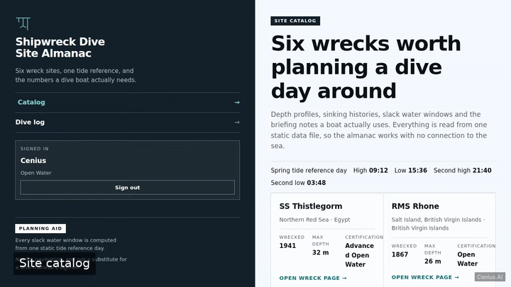
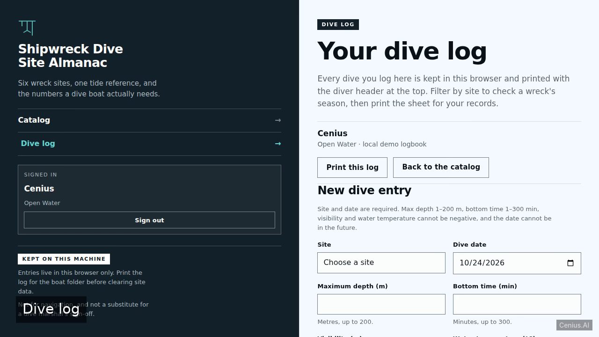
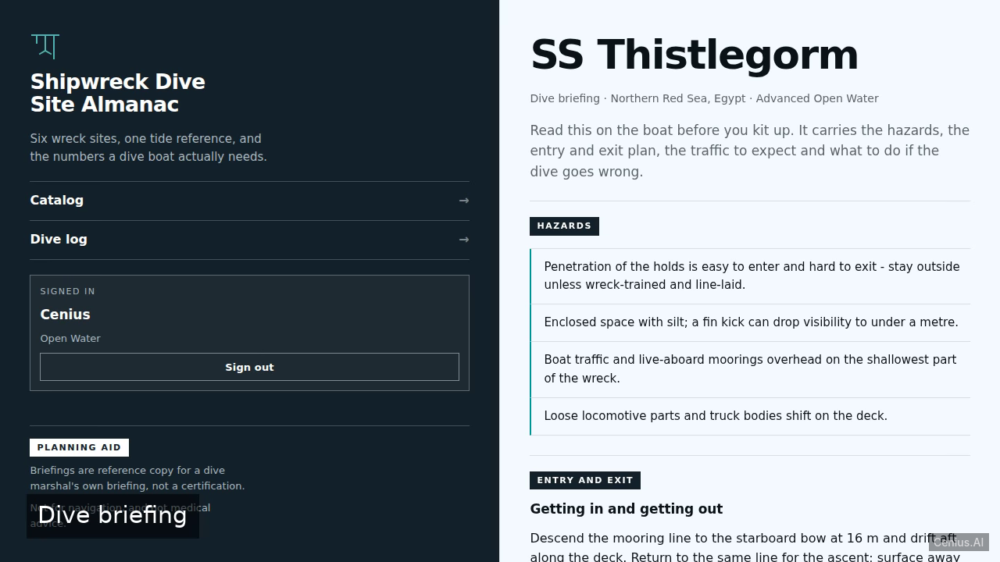

# Shipwreck Dive Site Almanac — Python knowledge base app reference implementation

If you want a self-hosted knowledge base app without the vendor lock-in, **Shipwreck Dive Site Almanac** is ready to run. Built with Python and Apache-2.0-licensed, Shipwreck Dive Site Almanac ships complete — one clone, one install command. A clean, minimal, fully static dive almanac served by nothing more than `python3 -m http.server`: four plain HTML pages (wreck finder, wreck detail, dive briefing, dive log) styled with hand-written CSS and driven by…. [Open Shipwreck Dive Site Almanac on cenius.ai](https://cenius.ai/marketplace/p/shipwreck-dive-site-almanac?ref=gh&utm_campaign=shipwreck-dive-site-almanac-python) to customise it without touching a line of Shipwreck Dive Site Almanac code.


[](LICENSE)  [](https://cenius.ai)

[](https://cenius.ai/marketplace/p/shipwreck-dive-site-almanac?ref=gh&utm_campaign=shipwreck-dive-site-almanac-python)

> **▶ [Open & edit in cenius.ai](https://cenius.ai/marketplace/p/shipwreck-dive-site-almanac?ref=gh&utm_campaign=shipwreck-dive-site-almanac-python)** — one click to an editable workspace: describe changes in plain English, get an instant preview, one-click deploy and host. Modifications made on the platform come with full rebrand & relicense rights.

_Local clone? See [Quick start](#quick-start) below. cenius.ai is the zero-setup path._

## Demo



📽 **[Watch the walkthrough](https://cenius.ai/marketplace/p/shipwreck-dive-site-almanac?ref=gh&utm_campaign=shipwreck-dive-site-almanac-python)** — plays on cenius.ai · [MP4 file](.github/media/demo.mp4)

## Screenshots

  

## Features

- Wreck pages with depth profile and sinking history
- Slack water window table per site
- Dive briefing safety page
- Printable dive log page
- Wreck finder home page

## Quick start

```bash
./install.sh   # installs dependencies + seeds demo data
```

See [`INSTALL.md`](INSTALL.md) for full setup and usage instructions.

## Architecture

`install.sh` takes care of packages and initial data in a single pass; nothing else is required before launching. The Python codebase (41 files) is self-contained — no external services needed to evaluate it. Top-level layout: `assets/`, `tests/`. Step-by-step setup guide: [`INSTALL.md`](INSTALL.md).

## Usage guide

Four screens, one dataset. Everything below works offline, in a plain browser, with the static
server running (`sh serve.sh`).

### 1. Catalog - `/`

Six wreck cards, each showing region, wreck year, max depth and the certification the site asks
for. The header above them names the tide reference day that every slack window on the site is
computed from. Click or keyboard-activate a card to open its wreck page.

States you may hit: skeleton cards while `data.json` loads, an empty-state panel if the file
publishes no sites, and an error panel with **Retry** if the file is missing or malformed.

### 2. Wreck page - `/wreck.html?id=thistlegorm`

- **Identity line** - vessel type, build year and length beside the wreck name.
- **Facts** - wreck year, max depth, required certification and position.
- **Depth profile** - a proportional bar from the surface to the seabed with markers for the
  shallowest point, the deck and the seabed, plus the numbers in metres underneath.
- **Sinking history** - the cause, the date and a short narrative account.
- **Slack water table** - one row for the site's own published window (anchor time, offset,
  start-end, length), then reference rows for the other three anchor times so you can check the
  arithmetic by hand. Midnight crossovers print as `23:40 - 00:25 (next day)`. A site with
  missing or invalid slack fields shows `No slack window published` instead of a blank cell.
- **Next** - the briefing, the log, or back to the catalog.

An unknown or missing `?id=` renders the shared error panel with a catalog link.

_Full guide: [`USAGE.md`](USAGE.md)_

## FAQ

### Can I deploy Shipwreck Dive Site Almanac on my own infrastructure?

`git clone` + `./install.sh` gets you a running instance — the install script provisions dependencies and demo data. Full steps live in [`INSTALL.md`](INSTALL.md); nothing external is needed to try it.

### How do I customise Shipwreck Dive Site Almanac's branding?

White-labeling is supported: fork the MIT-licensed source and rebrand it yourself, or use [cenius.ai](https://cenius.ai/marketplace/p/shipwreck-dive-site-almanac?ref=gh&utm_campaign=shipwreck-dive-site-almanac-python) to make changes in a guided workspace — platform modifications come with full rebrand rights.

### What if I want to add features to Shipwreck Dive Site Almanac without coding?

The easiest route: [visit the project on cenius.ai](https://cenius.ai/marketplace/p/shipwreck-dive-site-almanac?ref=gh&utm_campaign=shipwreck-dive-site-almanac-python), tell the platform what to change, and collect the updated build. No source-editing needed.

### What powers Shipwreck Dive Site Almanac under the hood?

The app is built with Python. What you see in this repo is the full production source, demo data included. Highlights include wreck pages with depth profile and sinking history.

### Is it OK to ship Shipwreck Dive Site Almanac as part of a product?

Confirmed free for commercial use — MIT terms let you incorporate, resell, or ship it in any product. [LICENSE](LICENSE).

## License & rebranding

Released under the [Apache License 2.0](LICENSE) (© 2026 Cenius AI) — free for personal and commercial use. The Cenius name/logo are trademarks (see NOTICE).

**Need a customized version?** [Remix this app on cenius.ai](https://cenius.ai/marketplace/p/shipwreck-dive-site-almanac?ref=gh&utm_campaign=shipwreck-dive-site-almanac-python) — modifications made on the platform come with **full rebrand & relicense rights** over your derivative.

## Built with cenius.ai

This entire application — code, design, seeded demo data — was generated on **[cenius.ai](https://cenius.ai)** from a plain-English description.

- 🚀 [Build your own app on cenius.ai](https://cenius.ai)
- 🎛️ [Remix Shipwreck Dive Site Almanac on the marketplace](https://cenius.ai/marketplace/p/shipwreck-dive-site-almanac?ref=gh&utm_campaign=shipwreck-dive-site-almanac-python) — open it in a workspace, prompt for changes, and ship your own version.

More open-source apps: [the Cenius-ai catalog](https://github.com/Cenius-ai) · [showcase index](https://github.com/Cenius-ai/showcase)
